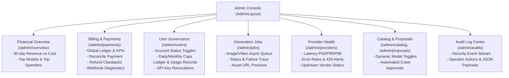

# Godance Admin Dashboard - Feature Specification (Spec)

> **Document Version**: v1.1.0  
> **Branch**: `feat/admin-dashboard`  
> **Status**: Approved & Implemented  
> **Architecture**: Monolith Full-Stack (Spring Boot 3 + React 18 / Vite)

---

## 1. System Overview & Problem Statement

### 1.1 Background & Motivation
In early iterations, the Godance administrative interface was limited to high-level financial aggregations and primitive manual credit adjustments. This created critical operational blind spots:
1. **Lack of Microscopic Usage Visibility**: The platform recorded granular invocation rows (`usage_records`), but operators could not inspect individual user model requests, tokens, or costs during billing disputes.
2. **Absence of User Governance & Risk Mitigation**: Support could not deactivate compromised or abusive user accounts, nor adjust daily/monthly credit caps, nor inspect and revoke leaked API keys.
3. **Black-box Asynchronous Media Tasks**: Long-running generation jobs (`generation_jobs`) for text-to-image and text-to-video lacked centralized queue inspection, failure diagnosis, or asset previews.
4. **Disjointed Payment Operations**: When Stripe or NOWPayments webhooks failed due to network timeouts, operators had no tooling to manually reconcile missed payments with idempotency guards, nor could they issue clawbacks/refunds or diagnose webhook signature anomalies.

### 1.2 Core Objectives
This feature builds an enterprise-grade, role-gated **Operator Console** that guarantees:
- **Comprehensive User Governance**: User account lifecycle management (active/banned status), daily/monthly credit ceiling enforcement, full usage trace inspection, and immediate API key revocation.
- **Robust Payment Reconciliation & Webhook Health**: Global payment transactions ledger, idempotent manual top-up reconciliation (`POST /v1/admin/payments/reconcile`), refund processing, and live webhook anomaly diagnostics.
- **End-to-End Multimodal Task Observability**: Global generation job queue monitoring across image and video modalities with latency and error tracking.
- **Provider & Model Catalog Operations**: Live P50/P95/P99 latency observability across upstream LLM vendors, real-time markup overrides, and automated price proposal approvals.
- **Strict Operator Accountability**: Full audit logging for every administrative action.

---

## 2. Operator Roles & Permissions Architecture

Administrative privileges are enforced server-side via the immutable `AdminAuthorizationFilter` email allowlist:

| Role | Access Level | Permitted Actions |
| :--- | :--- | :--- |
| **`SUPERADMIN`** | Full Platform Authority | • User Governance: Status freezing, credit ceiling caps, manual credit adjustments • Financials: Manual payment reconciliation, refunds, global transaction ledger • Model Governance: Catalog markup overrides, price proposal approvals/rejections • Security: API key revocation, full security audit inspection |
| **`ADMIN`** | Support & Operations | • Read-only inspection across users, jobs, logs, and provider health • Standard support adjustments (subject to audit logging) |

---

## 3. Core Functional Modules

### 3.1 Financial Overview & Revenue Analytics (`/admin/overview`)
- Aggregates daily net revenue, provider compute cost, and query volume over a sliding window (default 30 days).
- Ranks top 5 consumed models and top 5 spenders.
- Zero-fills inactive calendar days in UTC to ensure continuous charts.

### 3.2 Billing & Payment Reconciliation (`/admin/payments`)
- **Global Transaction Ledger**: Paged view of all credit ledger changes (`STRIPE`, `NOWPAYMENTS`, `REFUND`, `ADMIN_ADJUSTMENT`) with user email mapping, external transaction IDs, and delta amounts.
- **Manual Reconciliation (`reconcilePayment`)**:
  - Addresses offline wire transfers or missed webhook deliveries.
  - Generates a unique idempotency key (`reconcile-{paymentRef}`) to prevent duplicate credits.
  - Automatically records the `admin.payment.reconciled` audit event.
- **Refund & Clawback (`refundPayment`)**:
  - Debits user account balance via `CreditLedgerService.adminRefund`.
  - Appends negative `REFUND` ledger row and logs `admin.payment.refunded`.
- **Webhook Anomaly Diagnostics**:
  - Queries recent billing exceptions from `audit_logs`:
    - `billing.webhook.rejected` (Signature mismatch / timestamp drift)
    - `billing.webhook.ignored` (Unsupported webhook payload events)
    - `billing.autorecharge.failed` (Card declines / expired payment methods)
    - `billing.topup.duplicate` (Webhook replay attempts)
  - Provides instant JSON payload inspection modals for troubleshooting.

### 3.3 User Governance & Account Lifecycle (`/admin/users`)
- **Fuzzy Search**: Lookup by email substring or exact UUID (capped at 20 rows for sub-10ms response).
- **Account Freeze / Reactivation**: Toggles `User.active` with audit logging of previous and new states.
- **Budget Caps**: Configures `dailyCreditCapCents` and `monthlyCreditCapCents` to protect users and platform from runaway billing.
- **Three-Tier User Detail Drawer**:
  - **Tab 1: Ledger**: Chronological transaction history.
  - **Tab 2: Usage Records**: Per-request trace table displaying modality, model name, input/output tokens, cost, cache-hit flags, fallback flags, and upstream request IDs.
  - **Tab 3: API Keys**: Active keys inventory with one-click emergency revocation.

### 3.4 Generation Jobs Queue (`/admin/jobs`)
- Monitors async multimodal generation (`IMAGE`, `VIDEO`).
- Filterable by job status (`QUEUED`, `RUNNING`, `DONE`, `FAILED`) and modality.
- Displays prompt snippets, estimated vs. actual costs, execution duration, and direct artifact storage links (S3 / MinIO).

### 3.5 Provider Observability (`/admin/providers`)
- Interfaces with the unauthenticated, low-overhead `GET /v1/status` endpoint.
- Aggregates 5-minute rolling window metrics per `(provider, model)` pair.
- Visualizes P50, P95, and P99 latencies, request volume, error rates, and 429 rate limit triggers.

### 3.6 Security Audit Log Center (`/admin/audits`)
- Centralized append-only event stream backed by `audit_logs`.
- Filters by event taxonomy (`admin.*`, `billing.*`, `auth.*`, `apikey.*`).
- Displays operator email, target user ID, outcome badge (`SUCCESS`, `DENIED`, `FAILURE`), source IP, and formatted JSON event details.

---

## 4. Reliability & Idempotency Guarantees

1. **Double-Spend & Duplicate Credit Prevention**:
   - Every top-up and manual reconcile operation enforces a unique database constraint on `credit_ledger.idempotency_key`.
   - Repeated submissions of identical transaction references return HTTP `409 Conflict`.
2. **Atomic Balance Mutations**:
   - All balance updates execute via atomic SQL `UPDATE` operations (`incrementBalance`, `decrementBalanceIfSufficient`).
   - The authoritative source of truth is always computed via `SUM(credit_ledger.delta_cents)`.
3. **Transactional Audit Logging**:
   - Audit records are persisted within the same transactional boundary as the operational mutation.
