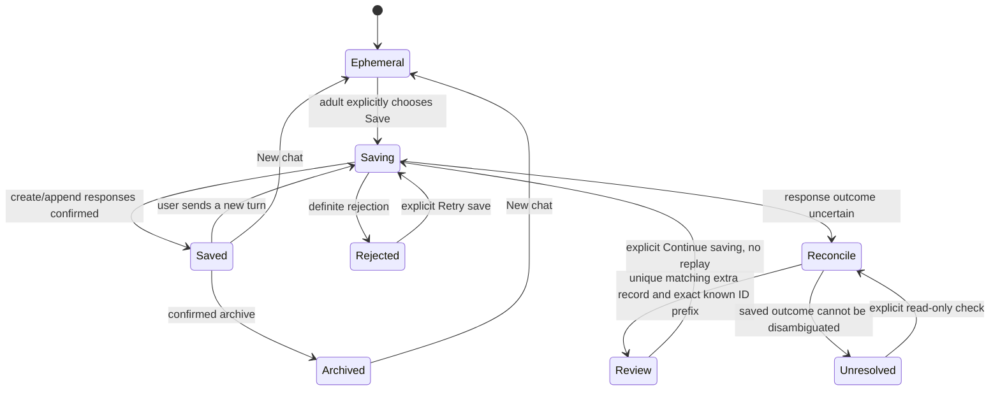

# Round 15 / 03 — Explicit adult chat history

Base B0: `8219e0497cb12a7be48b80915601811e361726bf`.
Implementation: `b63ceaf3c26622622532c2e9f2ed3a072d4c571d`; acceptance tests: `848b2b613bbd46874e013ef0369a1b35bfc2ffb7`, and keyboard/live-state plus asynchronous test-wait refinement `a995b138fef5fc59b4e4924832851b1edfdefe84`, followed by the narrow saved-title wrapping/regression correction and this evidence update.
Planning pack: `3de1b9d8f1e6021825ca6435cedb06a8ac43c6e1`, read in the original checkout rather than duplicated here.

## Result and contract

New chats are ephemeral. Adults can explicitly choose Save this chat, load active saved chats, continue one, start a new ephemeral chat, and confirm archival. Saved-history reads are requested through Saved chats; route entry does not fetch or create history. Every non-ADULT state keeps ephemeral generation with no history controls or conversation API calls. The existing parental notice and backend behavior are unchanged.

Only the existing signed-in-session conversation list/create/metadata/messages/append/archive routes are used. There is no rename, restore, hard deletion, message editing, invented cost or idempotency contract. The model request remains the stateless `/v1/chat/completions` call with its existing cookie/error behavior. A feature-owned reader exposes normal SSE completion evidence; truncated/failed/stopped assistant text remains visible and is excluded from persistence. Empty old placeholders are excluded from later model context.

Create/append writes run serially under one immediate lock. Returned IDs are retained before another append; only eligible unsaved messages are sent. A definite rejected write allows an explicit save retry; later model turns never retry a paused history write. An unknown create outcome remains unresolved, refetches the active list for review and never creates automatically again. An ambiguous append refetches metadata/messages: only the exact known ID prefix plus one matching additional record can be reconciled. Extra/missing/uncertain records remain unresolved. No exactly-once promise is made.

Generation and saving are separate: save failures preserve the completed answer and do not resend the paid model call. A synchronous submit guard prevents duplicate model requests even before React renders pending state. Switching/new/archive are disabled during streaming or writes. Local message identities and account+age-state mount keys fence callbacks; logout, account change or loss of ADULT eligibility clears the view and aborts pending work. No transcript is stored in browser storage, logs, telemetry or URLs.

Archive confirmation explains removal from the active list and the existing 30-day purge, not immediate erasure. Confirmed archived selections are read-only. Ambiguous archival stays explicitly unconfirmed/read-only until a GET checks it. Metadata is checked before continuing a saved chat and before appends; stale pre-archive list responses cannot re-add its active row. The backend still permits archived reads/appends until purge; this frontend does not claim an atomic cross-client archive/write guarantee.

## Shared baseline and checks

2026-11-16; Linux, Node v22.23.5, npm 10.9.9, America/Toronto; dedicated data-volume worktree and E2E_PORT=4183. All browser data, accounts and streams are synthetic; no paid provider or card operation was performed.

The common detached B0 app baseline passed `npm ci`, `npm run lint`, `npm run build`, and full desktop/mobile E2E: **1,340 passed**, no failures/skips. The coordinator also completed common B0 `mvn -B verify`: **2,297 tests**, no failures/errors/skips. Shared raw evidence remains ignored.

On this branch `npm ci`, `npm run lint`, `npm run build` passed. The inherited Vite large-chunk warning remains; no dependency was added or audit weakened. Opening cases against the old UI recorded **2 failed / 6 passed**: explicit save was absent, while non-adult ephemeral chat already avoided history calls. Initial new/existing chat checks passed **20**, then expanded safety checks passed **44**. Repeated expanded runs exposed a test synchronization race: the Send button remains visible while a saved-chat metadata preflight is pending. The helper now waits for actual composer submission before asserting stream completion/request bodies; all original duplicate-generation/no-blank assertions remain. Keyboard actions also positively wait for intentionally disabled loading controls to become enabled before focusing them. Raw failed-run evidence was retained, and the exact final source was rerun.

Final command: `E2E_PORT=4183 R15_CAPTURE_EVIDENCE=1 npm run test:e2e -- chat-history.spec.ts chat.spec.ts auth.spec.ts parental-consent.spec.ts sign-in-destination.spec.ts --workers=2` — **148 passed**, desktop/mobile, no failures/skips (34.5 seconds). It covers normal explicit saves/continuation/reload, retained read metadata/order, definite/ambiguous save failures, no generation replay, duplicate synchronous submits, serialized appends, child/unknown/pending-consent privacy, Stop/quiet EOF/no blank or partial saves, streaming selection locks, foreign/failed reads, archive confirmation/status/races, late stream/save callbacks across logout, and same-account age changes. A synthetic maximum-length unbroken saved title exposed a new-control overflow (393px viewport, 1,934px document) before correction. Two failing desktop/mobile regression cases were recorded, then the title button was bounded and selected-status text made to wrap; the final run checks list/selected state and 320px width. Screen-width assertions, Space/Enter activation and focus checks for saving/list/selection plus live persistence-state announcements and the existing sign-in return/consent journeys remain intact. `git diff --check` passed.

Full latest-head PR CI is a separate required gate, including backend (mvn verify), app (build), app (e2e), marketing (build) and any additional required check. This evidence does not label queued/running checks as green.

## Reviewed synthetic screenshots

| State | Desktop light / dark | Mobile light / dark |
| --- | --- | --- |
| Ephemeral, no history write | [Light](ephemeral-desktop-light.png) / [Dark](ephemeral-desktop-dark.png) | [Light](ephemeral-mobile-light.png) / [Dark](ephemeral-mobile-dark.png) |
| Explicitly saved | [Light](saved-desktop-light.png) / [Dark](saved-desktop-dark.png) | [Light](saved-mobile-light.png) / [Dark](saved-mobile-dark.png) |
| Save failed/unresolved, answer retained | [Light](save-failed-desktop-light.png) / [Dark](save-failed-desktop-dark.png) | [Light](save-failed-mobile-light.png) / [Dark](save-failed-mobile-dark.png) |

## Integration and remaining operator actions

Only ChatPage and feature-specific chat helpers/tests/evidence are changed. Existing routes/shell and all shared API/mock/navigation/global CSS files are untouched. All five feature branches independently target main at the common B0; suggested eventual integration order is 05/04, then 01, then 02/03. Merging, deployment and production/backend activation remain operator actions. This stream does not expand child persistence or change legal text.
